```mermaid
flowchart LR
    v010["v0.1.0\nBase Inicial"] --> v011["v0.1.1\nFix Audio & Carita"]
    v011 --> v012["v0.1.2\nWake Word 'Hola Loki'"]
    v012 --> v013["v0.1.3\nDiseño Bombón v1"]
    v013 --> v014["v0.1.4\nSync Ojos & Voz Kokoro"]
    v014 --> v015["v0.1.5\nBombón Canónica & V-Sync"]
    v015 --> v016["v0.1.6\nSonrisa ∪ & Miradas"]
    v016 --> v017["v0.1.7\nWake Word 'Hola Bombón'"]
    v017 --> v018["v0.1.8\nConversación Fluida"]
    v018 --> v019["v0.1.9\nOptimizaciones (Rollback)"]
    v019 --> v0110["v0.1.10\nBaseline Estable Actual"]
```

# Historial de Versiones y Evolución del Proyecto — Robot S3 (Bombón)

Este documento registra la evolución cronológica y técnica del firmware para el robot de escritorio basado en **ESP32-S3**, desde el estado inicial recibido hasta la versión estable actual. Cada conjunto de cambios está asociado a una interacción y numerado de forma incremental a partir de la versión **0.1.0**.

---

---

## [0.1.0] — Estado Inicial del Proyecto
**Fecha de referencia:** 21 de Octubre de 2026

### Descripción
Estado del proyecto al comenzar la sesión de trabajo. El dispositivo contaba con un flujo básico de asistente por botón físico.

### Arquitectura Base
- **Hardware:** ESP32-S3 (16MB Flash, 8MB Octal PSRAM), Pantalla ST7789, Micrófono I2S INMP441, Altavoz I2S MAX98357A, LED RGB direccionable, Botón físico.
- **Flujo:** Pulsación de botón físico $\rightarrow$ Graba 5 segundos $\rightarrow$ Envía WAV multipart a servidor STT Speaches $\rightarrow$ Envía texto a Ollama (`qwen3.8:27b`) $\rightarrow$ Envía respuesta a Speaches TTS $\rightarrow$ Reproducción PCM por I2S.
- **Interfaz gráfica:** Pantalla con textos en mayúsculas: `"ESCUCHANDO"`, `"PENSANDO"`, `"HABLANDO"`.

### Problemas Detectados
1. **Volumen de audio insuficiente:** El audio del parlante apenas se escuchaba por falta de amplificación/ganancia digital en el pipeline I2S.
2. **Cuelgues por desbordamiento de memoria:** Al recibir respuestas largas de Ollama, el ESP32 se reiniciaba por agotamiento de RAM interna (búferes estáticos en SRAM).
3. **Ausencia de expresividad:** Pantalla rudimentaria sin animación gráfica.

---

## [0.1.1] — Estabilidad de Memoria, Ganancia de Audio y Primera Carita Animada
**Interacción:** Solicitud inicial de corrección de cuelgues, audio bajo y carita hablando.

### Cambios Implementados
- **Gestión de Memoria en PSRAM:**
  - Se reubicaron los búferes de petición y respuesta HTTP de Ollama (`llm.c`) y del sintetizador de voz (`tts.c`) a la memoria externa **PSRAM** (`MALLOC_CAP_SPIRAM`), eliminando por completo los cuelgues ante respuestas extensas.
- **Optimización de Audio:**
  - Ajuste de ganancia digital y tasa de muestreo I2S en `speaker.c` para maximizar la potencia del MAX98357A sin saturar la señal.
- **Primera Carita Animada (LVGL):**
  - Creación de `display.c` con gráficos vectoriales en LVGL:
    - Ojos y boca que reaccionan a los estados del robot (`display_show_standby()`, `display_show_recording()`, `display_show_thinking()`, `display_show_speaking()`).
    - Animación de boca abriéndose y cerrándose al compás de la síntesis de voz.

---

## [0.1.2] — Wake Word "Hola Loki", Botón Mute/Unmute y Depuración Visual
**Interacción:** Eliminación de textos en pantalla, wake word "Hola Loki", botón como Mute/Unmute y fondo uniforme.

### Cambios Implementados
- **Depuración Visual:**
  - Se eliminaron por completo las etiquetas de texto de la pantalla.
  - El fondo de pantalla se mantuvo constante para evitar parpadeos molestos entre transiciones de estado.
- **Integración de microWakeWord:**
  - Se incorporó la biblioteca C++ `microWakeWord` adaptada para ESP-IDF en `wake_word.cpp` y `wake_word.h`.
  - Escucha continua en segundo plano sobre el flujo I2S del micrófono INMP441 mediante tensores en PSRAM (64 KB arena).
  - Enlace del modelo cuantizado `hola_loki_model.h` (`hola_loki_tflite`).
- **Comportamiento del Botón Físico:**
  - Al contar con activación por voz ("Hola Loki"), el botón físico pasó a cumplir la función de **Mute / Unmute** (silenciar / reactivar micrófono).
- **Indicación por LED RGB:**
  - Mantuvo la señalización cromática: Rojo = Grabando, Ámbar = Procesando/Pensando, Cian = Hablando.

---

## [0.1.3] — Rediseño Bombón (Las Chicas Superpoderosas), Control de LED y Calibración Acústica
**Interacción:** Cambio de apariencia a Bombón, calibración del parlante por distorsión y LED verde/apagado en standby.

### Cambios Implementados
- **Rediseño Facial Bombón v1:**
  - Sustitución de la carita genérica por el diseño de **Bombón (Blossom)** de *Las Chicas Superpoderosas*:
    - Paleta canónica: Piel `#FAD5C8`, Iris rosa `#F8959F`, Pupila negra `#020301`, Blanco del ojo `#FEFEFE`.
    - Geometría de ojos grandes caricaturescos y boca sutil.
- **Gestión de Estados de LED:**
  - Micrófono activo en reposo: **LED Verde**.
  - Micrófono silenciado (Mute): **LED Apagado**.
- **Atenuación de Distorsión:**
  - Calibración del volumen y escalado PCM en `speaker.c` para operar el parlante dentro de su zona lineal, eliminando la vibración del cono.

---

## [0.1.4] — Sincronización de Parpadeo y Transición a Voz Femenina
**Interacción:** Ojos asincrónicos al parpadear, entrecortes de audio y cambio a voz femenina más aguda.

### Cambios Implementados
- **Sincronización Ocular:**
  - Corrección del timer de parpadeo en `display.c`: unificación de los frames de cierre y apertura de ambos ojos para que parpadeen simultáneamente sin desfase temporal.
- **Sintetizador TTS Femenino:**
  - Cambio de la voz por defecto a la voz femenina en español `ef_dora` del modelo Kokoro-82M en `private_config.h`.
- **Estabilidad de Streaming de Audio:**
  - Ajuste de tamaños de lectura y búferes intermedios para evitar cortes de audio causados por jitter en la red Wi-Fi local.

---

## [0.1.5] — Rostro Canónico de Bombón, V-Sync Antitearing y Afinación de Pitch
**Interacción:** Ojos con 1 solo reflejo, pupila grande, párpado lavanda `#C1B9D8`, voz en español más aguda y eliminación de screen-tearing.

### Cambios Implementados
- **Rostro Canónico Fiel al Diseño:**
  - Ojos más redondos con pupila ensanchada e iris más angosto.
  - Eliminación del segundo brillo: **un único reflejo blanco grande** en la esquina superior de la pupila.
  - Animación de párpados en color lavanda `#C1B9D8` con línea divisoria central al parpadear.
- **Eliminación de Screen-Tearing (V-Sync):**
  - Implementación de doble búfer de dibujo en LVGL y sincronización en `display.c`, logrando refrescos limpios sin corte horizontal de pantalla.
- **Afinación de la Voz:**
  - Selección estricta de la voz femenina nativa en español (`ef_dora`).
  - Configuración de pitch elevado (+28%) y velocidad modulada (0.78) en `tts.c` para emular la voz dulce y joven de Bombón.

---

## [0.1.6] — Expresividad Dinámica: Miradas Aleatorias y Sonrisa en Arco `∪`
**Interacción:** Ojos que miren a diferentes lados, sonrisa en `∪` natural y corrección de la boca de asombro.

### Cambios Implementados
- **Miradas Aleatorias en Standby:**
  - Máquina de estados aleatoria para los ojos en reposo: mirada al frente, a la derecha, a la izquierda y abajo a la izquierda, alternando cada pocos segundos junto con los parpadeos.
- **Sonrisa en Arco `∪`:**
  - Rediseño de la boca mediante curvas de arco LVGL (`show_smile_arc`), simulando la sonrisa tierna `∪` de Bombón en lugar de una boca abierta que generaba expresión de asombro.

---

## [0.1.7] — Wake Word Personalizada "Hola Bombón"
**Interacción:** Incorporación del modelo `hola_bombon.tflite` en `main/models/`.

### Cambios Implementados
- **Nuevo Modelo microWakeWord:**
  - Conversión del binario `hola_bombon.tflite` a arreglo en C (`hola_bombon_model.h`).
  - Actualización de `wake_word.cpp` para utilizar `hola_bombon_tflite` con umbral de 0.80 y 5 pasos de ventana deslizante.
  - Verificación exitosa de activación local pronunciando *"Hola Bombón"*.

---

## [0.1.8] — Modo Conversación Continua y Detección Inteligente de Despedida
**Interacción:** Conversación fluida multi-turno tras la wake word hasta detectar frase de despedida ("chau", "hasta luego", etc.).

### Cambios Implementados
- **Sesión Conversacional Multi-Turno:**
  - Tras activarse con *"Hola Bombón"*, el robot entra en un bucle interactivo continuo sin requerir repetir la palabra de activación en cada turno.
  - Implementación de historial de conversación en PSRAM con ventana deslizante de hasta 12 turnos en `llm.c`, permitiendo recordar preguntas previas.
- **Interpretación Semántica de Despedida:**
  - System prompt instruyendo al modelo a añadir la etiqueta `[DESPEDIDA]` cuando el usuario manifieste intención de cierre.
  - Filtro local de respaldo en español (`chau`, `adiós`, `hasta luego`, `nos vemos`, `después hablamos`, etc.).
  - Bombón se despide afectuosamente y finaliza la sesión regresando a reposo (LED verde).
- **Saludo Inicial y Cierre por Inactividad:**
  - Si el usuario dice *"Hola Bombón"* y no habla de inmediato, el robot responde *"¡Hola! Te escucho."* y se queda atento.
  - Cierre automático de sesión tras 2 turnos consecutivos de silencio o al presionar el botón físico.

---

## [0.1.9] — Paquete de Optimización Experimental (VAD, 4B y Streaming) [Rollback]
**Interacción:** Intento de reducir la latencia aplicando simultáneamente VAD en micrófono, modelo Ollama `qwen3.5:4b-q4_K_M` y streaming de tokens.

### Cambios Probados
- **A (Micrófono):** Detección de Actividad de Voz (VAD por energía acústica) para cortar la grabación al terminar de hablar.
- **B (LLM):** Reducción de parámetros del modelo cambiando a `qwen3.5:4b-q4_K_M`.
- **C (Streaming):** Lectura HTTP chunked en Ollama para enviar texto a TTS en fragmentos.

### Incidencias Encontradas
- El parser de streaming HTTP en ESP-IDF cortaba la lectura en el primer límite de paquete TCP (`ans_pos == 0`).
- El VAD por energía acústica cortaba la grabación por falsos silencios antes de tiempo.
- Consecuencia: Al decir *"Hola Bombón"*, decía *"¡Hola! Te escucho."* y se desconectaba inmediatamente volviendo al LED verde.

---

## [0.1.10] — Restauración del Baseline Estable ("Lento pero Bien") [Versión Actual]
**Interacción:** Reversión completa a la versión previa para validar estabilidad y probar mejoras una a una.

### Cambios Implementados
- **Micrófono:**
  - Reversión completa a la función estable de 5 segundos fijos (`microphone_record_five_seconds`).
- **Modelo LLM:**
  - Restauración del modelo canónico `qwen3.8:27b` en `private_config.h`.
- **Protocolo HTTP:**
  - Retorno a la llamada POST estándar no-streaming (`"stream": false`) con búfer de 16 KB en PSRAM y extracción limpia de respuesta en `llm.c`.
- **Lógica de Silencios en Turno 0:**
  - Corrección en `main.c`: al emitir el saludo de cortesía *"¡Hola! Te escucho."*, se reinicia `consecutive_silence = 0`, evitando que compute como primer error de inactividad.
- **Preservación de Features:**
  - Wake word *"Hola Bombón"* activa.
  - Expresiones faciales canónicas de Bombón (ojos redondos, iris rosa, reflejo único, párpado lavanda, miradas aleatorias y sonrisa en `∪`).
  - Memoria conversacional multi-turno y detección semántica de despedida.

---

## Matriz Resumen de Versiones

| Versión | Hito Principal | Wake Word | Gráfica / Rostro | Modelo LLM | Voz TTS |
| :---: | :--- | :---: | :---: | :---: | :---: |
| **0.1.0** | Base inicial del proyecto | Ninguna (Botón) | Texto plano | `qwen3.8:27b` | Masculina por defecto |
| **0.1.1** | Memoria PSRAM y Primera Carita | Ninguna (Botón) | Carita animada v1 | `qwen3.8:27b` | Masculina por defecto |
| **0.1.2** | Wake Word "Hola Loki" & Mute | "Hola Loki" | Carita sin textos | `qwen3.8:27b` | Masculina por defecto |
| **0.1.3** | Rediseño Bombón v1 & LED verde | "Hola Loki" | Bombón v1 | `qwen3.8:27b` | Masculina calibrada |
| **0.1.4** | Sync Ojos & Voz Femenina | "Hola Loki" | Bombón ojos sincronizados | `qwen3.8:27b` | `ef_dora` (Kokoro) |
| **0.1.5** | Bombón Canónica & V-Sync | "Hola Loki" | Canónica (lavanda, 1 reflejo) | `qwen3.8:27b` | `ef_dora` (+28% pitch) |
| **0.1.6** | Miradas Aleatorias & Sonrisa `∪` | "Hola Loki" | Canónica + Sonrisa `∪` | `qwen3.8:27b` | `ef_dora` (+28% pitch) |
| **0.1.7** | Wake Word "Hola Bombón" | "Hola Bombón" | Canónica + Sonrisa `∪` | `qwen3.8:27b` | `ef_dora` (+28% pitch) |
| **0.1.8** | Conversación Fluida Multi-Turno | "Hola Bombón" | Canónica + Sonrisa `∪` | `qwen3.8:27b` | `ef_dora` (+28% pitch) |
| **0.1.9** | Optimizaciones A+B+C *(Inestable)* | "Hola Bombón" | Canónica + Sonrisa `∪` | `qwen3.5:4b-q4_K_M` | `ef_dora` (+28% pitch) |
| **0.1.10** | **Baseline Estable Restaurado (Actual)** | **"Hola Bombón"** | **Canónica + Sonrisa `∪`** | **`qwen3.8:27b`** | **`ef_dora` (+28% pitch)** |
